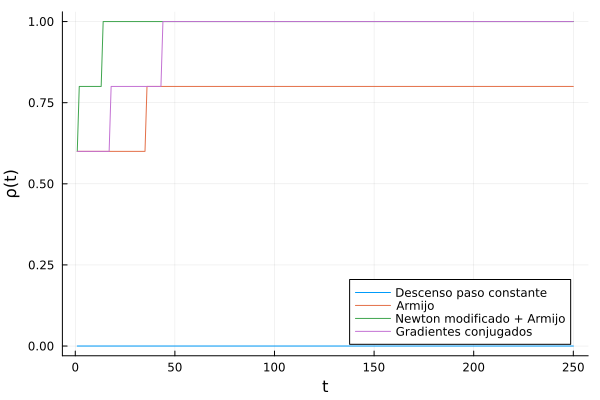

# Descent Algorithms

Implementation of first and second order descent methods: constant step gradient descent, Armijo line search, modified Newton's method with Armijo, and nonlinear conjugate gradients (Fletcher–Reeves). Performance is compared across benchmark functions using the Dolan–Moré performance profile.

## Performance profile



The curve ρ(t) gives the fraction of problems a method solves within a factor `t` of the best method's iteration count. Higher and further left is better; methods that did not converge count as infinite ratio.

## Benchmark functions

Sphere, Rosenbrock, Rastrigin (n = 2), Wood (n = 4) and Freudenstein–Roth (n = 2). Gradients and Hessians are analytical (see `benchmarks.jl`).

## Usage

```julia
julia main.jl
```

This runs every method on every problem, prints the results and saves the plot to `img/desempeno.png`.

## Structure

- `optimizer.jl`: optimizers and the generic `descent` loop.
- `benchmarks.jl`: test functions with their gradients and Hessians.
- `main.jl`: runs the comparison and builds the performance profile.
